# 2026 F题｜李萨如图形显示控制装置

这个装置用来控制示波器 X-Y 模式下的李萨如图形。MSPM0G3507 驱动 AD9959 调整输出频率、相位和幅度，使屏幕显示对角线、圆和“∞”，并提供 2/4/6/8 div 四档幅度。常规模式利用电输入和鉴相反馈；要求 5 则通过 UVC 摄像头观察屏幕，完成测频和图形调整。

仓库包含主控固件、视觉程序、原理图和设计报告，也保留了从线阵 CCD 到整屏视觉的探索过程。年度题库、训练工程和通用模块资料集中在 [2026-Ti 备赛资产库](https://github.com/liusuan110/2026-Ti)。

## 先看什么

想理解设计，先读[方案与实现](docs/SOLUTION.md)：从图形需要什么控制量，讲到电锁相、光学测频和形状保持。

准备运行工程，直接进入[复现指南](docs/REPRODUCE.md)：按顺序导入 CCS、检查串口、启动相机和按键服务，每一步都列出可以观察的现象。

需要原理图和正式叙述，打开[设计报告](F题设计报告/readme.md)；想回看开发过程和实验数据，阅读[工程演进与测试记录](docs/ARCHIVE.md)。

## 装置怎样工作

示波器 X 轴接信号源，Y 轴接装置输出。频率比决定图形有几个环，相位决定它怎样展开，幅度决定屏幕上的跨度。AD9959 把这三个量变成可调参数，主控根据电测或图像反馈持续修正输出。

要求 1～4 从电输入获得频率和相位信息。要求 5 只通过屏幕观察未知信号：先用已知窗口的斜坡辅助测频，再切换到 DDS 输出，保持目标形状。两种方式共用同一套主控和 DDS。

## 硬件与控制架构

```mermaid
flowchart TB
  subgraph R14["要求 1～4：电测频与电锁相"]
    direction LR
    S14["信号源"] -->|"X 轴"|O14["示波器 X-Y"]
    S14 --> C14["输入调理与整形"]
    C14 -->|"PA16：电输入测频"|M14["MSPM0G3507<br/>测频、锁相与模式控制"]
    C14 --> P14["PFD 鉴频鉴相<br/>与低通"]
    D14["AD9959"] -->|"CH1：整形后作参考"|P14
    P14 -->|"PA27：反馈电压"|M14
    M14 -->|"GPIO 串行控制总线"|D14
    D14 -->|"CH0"|A14["滤波与输出放大"]
    A14 -->|"DDS 路径"|K14["直通 / DDS 继电器"]
    S14 -->|"直通路径"|K14
    M14 -.->|"PA13：路径选择"|K14
    K14 -->|"Y 轴"|O14
  end

  subgraph R5["要求 5：UVC 光学自动控制"]
    direction LR
    S5["未知信号源<br/>仅接示波器"] -->|"X 轴"|O5["示波器 X-Y"]
    O5 -.->|"屏幕图像"|U5["UVC 摄像头"]
    U5 -->|"USB"|V5["DK / Linux：Python + OpenCV<br/>盲测频、FTW 锁定、形状闭环"]
    V5 <-->|"UART0 115200<br/>按键事件 / 控制参数"|M5["MSPM0G3507"]
    M5 -->|"GPIO 串行控制总线"|D5["AD9959"]
    M5 -->|"PA15：DAC 窗口斜坡"|Y5["Y 轴分阶段接入"]
    D5 -->|"CH0"|A5["滤波与输出放大"]
    A5 -->|"目标图形输出"|Y5
    Y5 -->|"Y 轴"|O5
  end
```

图中的“Y 轴分阶段接入”表示测频与图形输出两个阶段，切换方式随实物接线确定。按键和编码器负责操作，RGB、外部 LED 与蜂鸣器显示运行状态。完整引脚表见[复现指南](docs/REPRODUCE.md#接线速查)。

## 软件从哪里读

| 部分 | 入口 | 阅读重点 |
| --- | --- | --- |
| 主控应用 | [User/App.c](User/App.c) | 主循环、按键、命令解析、电锁相和输出模式 |
| 外设与时序 | [User](User/) · [SysConfig](ContestTemplate_2026.syscfg) | AD9959、ADC/DMA、DAC、1 ms 时基和引脚配置 |
| 一键视觉流程 | [按键服务](DK2500_vision/requirement5_button_service.py) → [目标编排](DK2500_vision/requirement5_target.py) | 从物理按键到测频、锁定和形状控制 |
| 视觉算法 | [盲锁](DK2500_vision/fast_phase_lock.py) · [形状控制](DK2500_vision/shape_control.py) | 频率候选、精确控制字交接和持续反馈 |
| 报告与硬件资料 | [F题设计报告](F题设计报告/readme.md) | 系统方案、原理图、插图和已有 PDF |

主控工程名沿用 `ContestTemplate_2026`。从 [ContestTemplate_2026.c](ContestTemplate_2026.c) 进入初始化与主循环；视觉程序从按键服务向下阅读，更容易看清各脚本之间的数据流。
