# 2026 F题｜李萨如图形显示控制装置

本仓库归档 2026 年 F 题的完整工程、方案演进和设计报告：以 **MSPM0G3507 + AD9959** 为控制核心，实现直通、同频正交、二倍频和幅度档位控制，并保留要求 5 的 UVC 摄像头视觉自动控制代码。

年度备赛资料、历年题目、训练工程和通用模块请到 [2026-Ti 备赛资产库](https://github.com/liusuan110/2026-Ti)。本仓库保持可更新；“归档”指内容整理和版本留痕。

## 从哪里开始

| 目的 | 入口 |
| --- | --- |
| 看系统思路、方案取舍与代码对应关系 | [方案与实现](docs/SOLUTION.md) |
| 导入 CCS、核对接线、启动视觉流程 | [复现指南](docs/REPRODUCE.md) |
| 看归档基线、历史资料与验证边界 | [归档说明](docs/ARCHIVE.md) |
| 阅读报告、原理图与插图 | [F题设计报告](F题设计报告/readme.md) · [报告 PDF](F题设计报告/电赛F题_设计报告.pdf) |
| 修改主控程序或外设配置 | [User/App.c](User/App.c) · [SysConfig](ContestTemplate_2026.syscfg) |
| 阅读最终视觉主流程 | [按键服务](DK2500_vision/requirement5_button_service.py) → [流程编排](DK2500_vision/requirement5_target.py) |

## 工程组成

- **MCU 固件**：根目录为 CCS 工程，工程名沿用 `ContestTemplate_2026`。应用逻辑在 `User/App.c`，驱动包括 AD9959、ADC/DMA、DAC、按键、编码器、RGB 和声光提示。
- **视觉控制**：`DK2500_vision/` 包含摄像头服务、斜坡轨迹测频、FTW 精调、三种图形视觉反馈和一键流程。
- **报告与硬件**：`F题设计报告/` 包含 Typst 源码、已有 PDF、原理图和框图。
- **早期探索**：TSL1401 线阵驱动、`tools/ccd_live_view.ps1` 及旧联调文档保留，用于理解 CCD 路线到 UVC 路线的演进。

## 两条工作链路

**要求 1～4**：电输入测频 / PFD 反馈 → MCU 控制 → AD9959 → 输出放大与继电器 → 示波器 Y 轴。

**要求 5**：信号源仅接示波器 X 轴 → 摄像头拍屏 → 斜坡测频与盲锁 → 精确 FTW 交接 → 目标图形视觉闭环 → MCU / AD9959 输出 Y 轴。最终 UVC 流程由物理按键和 Python 按键服务启动；固件中的 `fauto` 仍属于本地 CCD 路线。

## 硬件与控制架构

```mermaid
flowchart TB
  subgraph R14["要求 1～4：电测频与电锁相"]
    direction LR
    S14["信号源"] -->|"X 轴"|O14["示波器 X-Y"]
    S14 --> C14["输入调理与整形"]
    C14 -->|"PA16：电输入测频"|M14["MSPM0G3507<br/>测频、锁相与模式控制"]
    C14 --> P14["PFD 鉴频鉴相<br/>与低通"]
    D14["AD9959"] -->|"CH1：整形后作参考"|P14
    P14 -->|"PA27：反馈电压"|M14
    M14 -->|"GPIO 串行控制总线"|D14
    D14 -->|"CH0"|A14["滤波与输出放大"]
    A14 -->|"DDS 路径"|K14["直通 / DDS 继电器"]
    S14 -->|"直通路径"|K14
    M14 -.->|"PA13：路径选择"|K14
    K14 -->|"Y 轴"|O14
  end

  subgraph R5["要求 5：UVC 光学自动控制"]
    direction LR
    S5["未知信号源<br/>仅接示波器"] -->|"X 轴"|O5["示波器 X-Y"]
    O5 -.->|"屏幕图像"|U5["UVC 摄像头"]
    U5 -->|"USB"|V5["DK / Linux：Python + OpenCV<br/>盲测频、FTW 锁定、形状闭环"]
    V5 <-->|"UART0 115200<br/>按键事件 / 控制参数"|M5["MSPM0G3507"]
    M5 -->|"GPIO 串行控制总线"|D5["AD9959"]
    M5 -->|"PA15：DAC 窗口斜坡"|Y5["Y 轴分阶段接入"]
    D5 -->|"CH0"|A5["滤波与输出放大"]
    A5 -->|"目标图形输出"|Y5
    Y5 -->|"Y 轴"|O5
  end
```

要求 1～4 使用电输入和鉴相反馈；要求 5 断开信号源与装置的电气连接，由摄像头观察示波器屏幕完成闭环。两部分共用同一套主控与 DDS，图中分开绘制以说明各自的信号路径。

要求 5 先用 DAC 窗口斜坡辅助视觉测频，再接入 DDS 输出并持续调整频率与相位；图中的“分阶段接入”表示逻辑信号路径，具体切换按实物接线执行。TSL1401 / CCD 作为早期探索保留，未画入当前 UVC 主流程。

PA1 驱动外部蜂鸣器与 LED，按键、编码器和 RGB 负责交互与状态提示。完整引脚表见[复现指南](docs/REPRODUCE.md)，模拟电路见 [F题报告与原理图](F题设计报告/readme.md)，算法与代码对应关系见[方案与实现](docs/SOLUTION.md)。

## 环境与复现状态

工程配置记录：CCS 12.7、TI ARM LLVM 4.0.2 LTS、MSPM0 SDK 2.10.00.04、SysConfig 1.26.2；MCU 为 MSPM0G3507，PA6 需要外部 40 MHz 时钟。DDS 的 25 MHz 系统时钟与 MCU 外部时钟是不同配置。

Python 视觉代码使用 OpenCV、NumPy 和 pyserial，仓库未锁定依赖版本。相机画幅、ROI、串口及幅度参数需要按实物确认，详见复现指南。

仓库保存了幅度标定和部分光学测试记录；本次整理仅核对源码、配置和文档，未重新编译或上板测试。要求 5 的最终版本仍需补齐全频段、三模式的控制时间与稳定性日志，不能把已有代码或报告结论等同于全指标验收。

## 历史记录

[F_CONTROLLER_BRINGUP.md](F_CONTROLLER_BRINGUP.md)、[REQUIREMENT5_BRINGUP.md](REQUIREMENT5_BRINGUP.md) 和 [TOMORROW_CHECKLIST.md](TOMORROW_CHECKLIST.md) 保留原始阶段内容。遇到旧的“待实现”、按键定义和模板资源占用数据，应结合当前源码与[归档说明](docs/ARCHIVE.md)判断。
