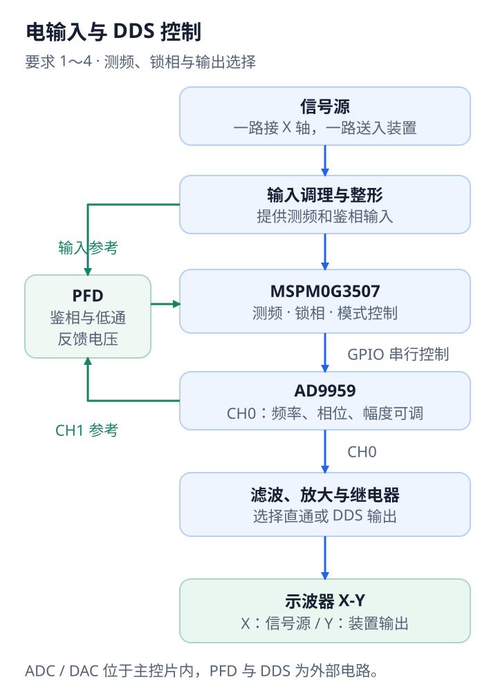

# 桌上有哪些硬件，它们怎样连接

这套装置分成控制、模拟信号和屏幕观测三部分。MSPM0G3507 管理时序与参数，AD9959 产生可调正弦信号，模拟电路完成输入调理与输出放大；示波器把两路信号变成图形，摄像头再把图形送回控制程序。

## 硬件分工

| 部件 | 在系统里负责什么 | 与谁连接 |
| --- | --- | --- |
| MSPM0G3507 主控板 | 测频、读取鉴相反馈、驱动 DDS；片上 DAC 输出窗口斜坡 | 前端、AD9959、继电器、按键与串口 |
| 外部时钟 | 给主控 PA6 提供 40 MHz，生成 80 MHz CPU 时钟 | 主控板 |
| AD9959 模块 | CH0 生成最终 Y 轴信号，CH1 用作电锁相参考 | 主控 GPIO 串行总线、PFD、输出放大器 |
| 输入调理与 PFD | 调理信号源输入，将两路整形信号的相位关系转换为反馈电压 | PA16 测频输入、PA27 反馈输入 |
| 滤波与输出放大 | 把 DDS 输出调成示波器需要的电压跨度 | AD9959 CH0 与输出端 |
| 直通 / DDS 继电器 | 在输入直通和 DDS 放大输出之间选择 | PA13 控制，输出接示波器 Y |
| 信号源与示波器 | 提供测试正弦，显示 X-Y 图形 | 信号源接 X，装置输出接 Y |
| UVC 摄像头与 DK/Linux 主机 | 拍摄屏幕、识别频率和形状、计算调整量 | 相机走 USB；主机通过 USB-TTL 接主控 UART0 |
| USB-TTL / J-Link | 前者传控制命令和日志，后者烧录与调试固件 | UART0 / SWD |
| 按键、编码器、RGB 与声光电路 | 选择目标、调相位、显示流程状态 | 主控 GPIO，外部声光由 PA1 驱动 |

DDS 的系统时钟在本工程中设为 25 MHz，与主控 PA6 的 40 MHz 是两路不同的时钟。相关电路图集中在[F题设计报告](../F题设计报告/readme.md)。

## 电输入模式的连接

信号源一支接示波器 X 轴，另一支进入输入调理电路。调理后的信号送到 PA16 测频，并经整形进入 PFD；AD9959 CH1 经整形作为另一端参考。PFD 低通输出接 PA27，主控据此修正输出。

AD9959 CH0 经滤波与放大进入继电器的 DDS 路径；输入信号同时保留一条直通路径。PA13 为低时，继电器释放并走直通；为高时，选择 DDS 放大输出。继电器公共输出接示波器 Y 轴。

装好后从 10 kHz 和直通开始，将 X、Y 调到 8 div，再检查 DDS 和电锁相。完整操作顺序见[复现指南第2节](REPRODUCE.md#2-检查电输入和-dds-输出)。

## 光学模式：Y 轴在两个阶段接收不同信号

光学模式中，未知信号源只接示波器 X 轴，装置通过摄像头观察屏幕。Y 轴先使用 PA15 的窗口斜坡，把纵向位置变成已知的时间刻度；得到频率后，再使用 AD9959 CH0 的放大输出形成目标图形。

接线时分别检查这两条模拟路径：**PA15 的斜坡能够到达 Y 轴，CH0 的放大输出也能够到达 Y 轴。** 下表把程序动作和引脚状态放在一起，便于逐段观察。

| 阶段 | 程序动作 | PA13 / 继电器 | PA15 / DAC | Y 轴需要接收的信号 |
| --- | --- | --- | --- | --- |
| 窗口测频 | `fwindow <窗口微秒数>` | 低电平，释放 | 输出窗口斜坡 | PA15 斜坡经模拟接入路径到 Y |
| 结束粗测 | `fwindow off` | 保持低电平 | 停止，输出高阻 | 准备切入 DDS |
| DDS 候选搜索 | `fset <频率> <幅度> <相位>` | 高电平，选择 DDS | 停止，输出高阻 | CH0 经滤波放大后到 Y |
| 图形保持 | 持续更新 DDS 参数 | 保持 DDS 路径 | 保持高阻 | CH0 输出目标信号 |
| 结束当前目标 | 复位 MCU | 回到低电平 | 停止 | DDS 关闭，按键服务回到监听 |

PA15 从主控扩展口引出，用于测频阶段的 Y 轴斜坡；从扩展口到示波器 Y 轴之间的外部接线，现有图纸尚未标出，装配时需把这一段补到实物接线图中。上表列出各阶段信号来源与输出状态，便于沿路径检查。

输出切换对应 [App.c](../User/App.c) 的 `fwindow`、`applySingleOutput`、`relaySelectDirect` 和 `relaySelectDDS`；PA15 的停止与高阻处理在 [DacOutput.c](../User/DacOutput.c)。

## 两台主机各做什么

开发电脑运行 CCS，通过 J-Link 烧录和调试。连接摄像头、USB-TTL 的 DK/Linux 主机运行整个 Python 视觉目录。可以在两台主机各取一份同版本源码：开发电脑打开根目录 CCS 工程，DK/Linux 进入 `DK2500_vision/`。

DK/Linux 上保留两个终端：一个运行相机服务，另一个运行按键服务。脚本默认从 `127.0.0.1:8080` 读取本机图像；从开发电脑看画面时，用 `http://<DK主机IP>:8080/` 打开同一服务。

接着按[复现指南](REPRODUCE.md)启动程序。按键定义、UART、SWD 和全部引脚也在指南中集中列出。
